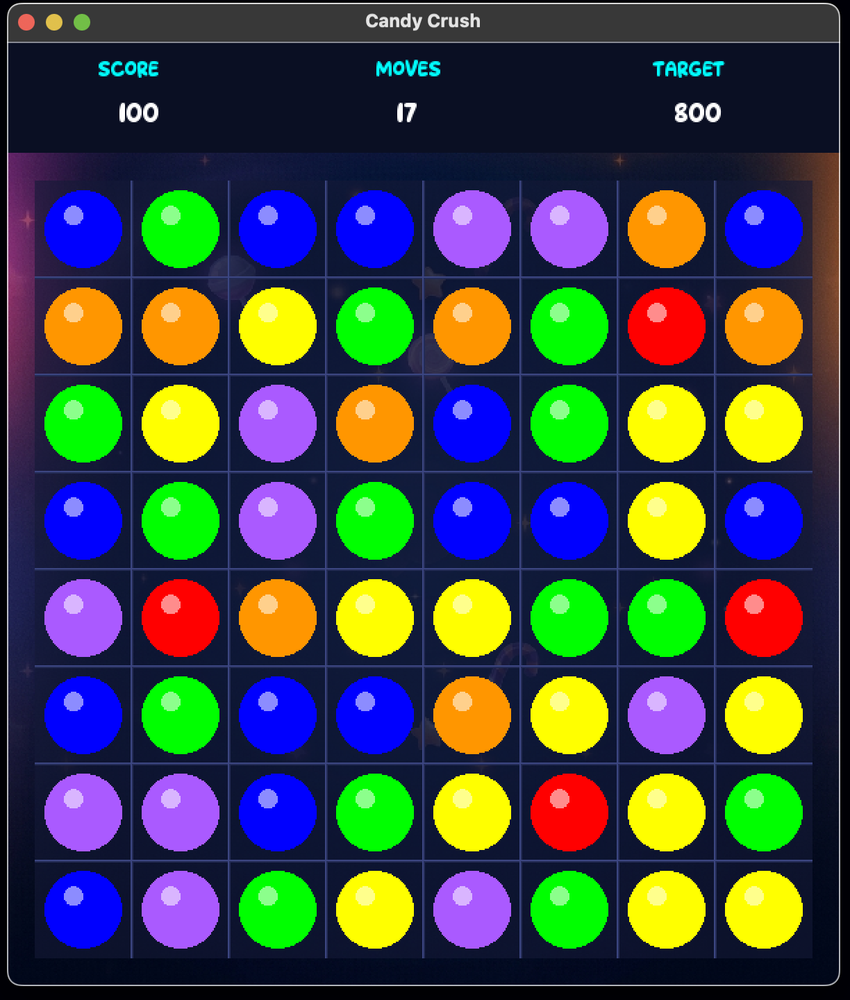
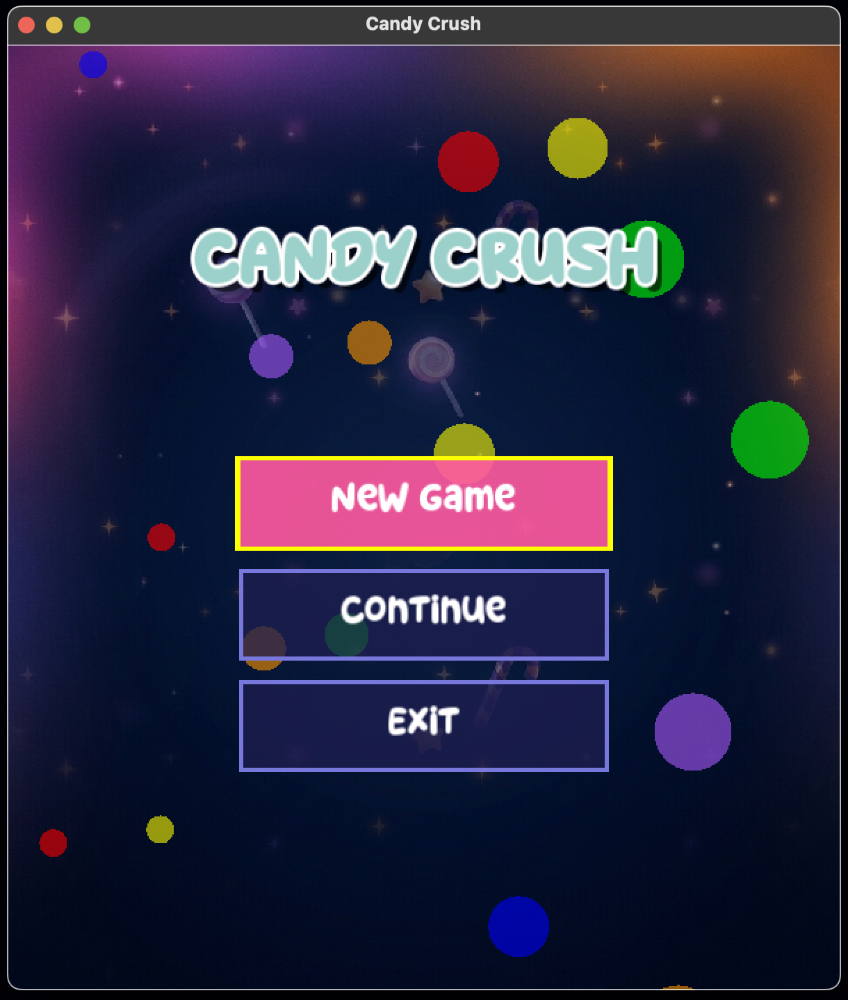

CANDY CRUSH
CS1002 Programming Fundamentals, Fall 2026
National University of Computer and Emerging Sciences, Lahore

A match-three puzzle game written in C++ with SFML 3.0.2. Swap
neighbouring candies to line up three or more of the same colour,
and reach the target score before you run out of moves.

TEAM MEMBERS
------------
Member A: Abdul Muqeet, Roll No. L26-0054
  Foundation and display (window, game loop, level loading, board
  drawing, selection and swapping)

Member B: Sara Hanif, Roll No. L26-0038
  Game engine (finding matches, clearing, falling, refilling, chains)

Member C: Arfa Nasir, Roll No. L26-0036
  Game flow and saving (menu, game states, HUD, moves and winning,
  save and continue)

ABOUT THE GAME
--------------
The board is an 8 x 8 grid of candies in 6 colours. Click a candy to
select it, then click a neighbouring candy to swap them. If the swap
makes a match of three or more candies in a row or column, the matched
candies disappear, the candies above fall down, and new candies drop
in from the top. New matches formed by falling candies create chains.
Every cleared candy gives 10 points, and a whole chain uses only one
move.

You win by reaching the target score within the given number of moves.
If the moves run out first, the game is over. The starting board,
number of moves and target score are read from level.txt (sample
level: 20 moves, 800 points).

CONTROLS
--------
Menu:
  Up / Down arrow ... move between New Game, Continue and Exit
  Enter ............. choose the highlighted option

While playing:
  Mouse click ................ select a candy
  Click a neighbouring candy . swap the two candies (swapped back if
                               there is no match, no move is used)
  Click any other candy ...... select that candy instead
  Esc ........................ save the game to savegame.txt and
                               return to the menu

Game Over / You Win screen:
  Enter ............. return to the menu

Clicks outside the board are ignored. Closing the window with the X
button exits the game at any screen.

FEATURES
--------
- Game window (600 x 680, 60 FPS) with a game loop of handleInput,
  updateGame and drawGame
- Board, moves and target loaded from level.txt, with an error
  message if the file is missing
- Mouse selection with a white ring, neighbour-only swapping, and
  swap-back when no match is made
- Match finding in rows and columns, including lines of 4 or 5 and
  L or T shapes
- Clearing, falling, refilling and chain reactions
- HUD showing score, moves left and target
- Menu and game states handled with switch and named constants
- Save and continue using savegame.txt (the save is emptied when a
  game ends)

HOW TO RUN
----------
You need Windows with Visual Studio 2022 (workload: Desktop
development with C++).

1. Download SFML 3.0.2 (Visual C++ 17 (2022) - 64-bit) from
   sfml-dev.org and extract it to C:\SFML-3.0.2
2. Clone this repository.
3. Open the .sln file in Visual Studio 2022.
4. Select x64 and Debug in the top bar.
5. Copy the three SFML debug DLLs (sfml-graphics-d-3.dll,
   sfml-window-d-3.dll, sfml-system-d-3.dll) from C:\SFML-3.0.2\bin
   into the x64\Debug output folder.
6. Press F5 to build and run.

Notes:
- Always run the game from Visual Studio (F5). level.txt and
  arial.ttf must stay in the project folder next to the source file,
  otherwise the game will not find them.
- The project uses C++17 and expects SFML in exactly C:\SFML-3.0.2
- Build folders (x64, Debug, .vs) are not part of the repository.

FILES
-----
main.cpp ......... all game code, grouped into sections by owner
level.txt ........ starting board, number of moves and target score
savegame.txt ..... saved game (created and emptied by the game)
arial.ttf ........ font used for text

## Screenshots

### Gameplay

### Menu

LEVEL.TXT FORMAT
----------------
Line 1: rows and columns (8 8)
Line 2: moves and target score (20 800)
Next 8 lines: 8 candies each (1 to 6, 0 = empty)

SAVEGAME.TXT FORMAT
-------------------
Line 1: score, moves left, target score (for example 640 12 800)
Next 8 lines: the 8 rows of the current board

The selected candy is not saved, so nothing is selected after
Continue.

